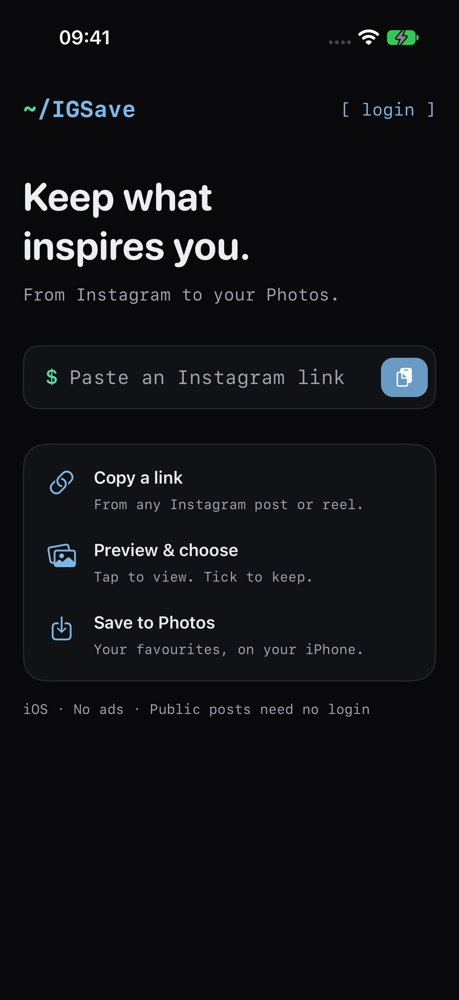
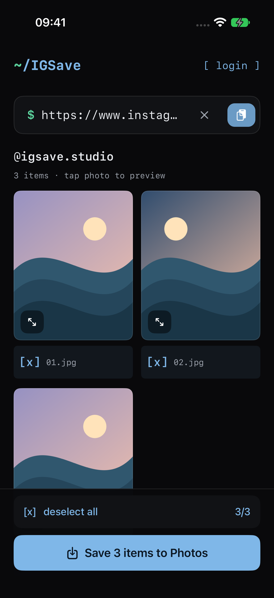
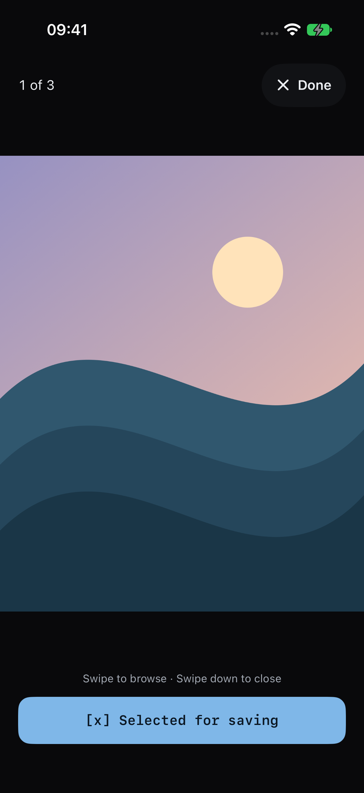
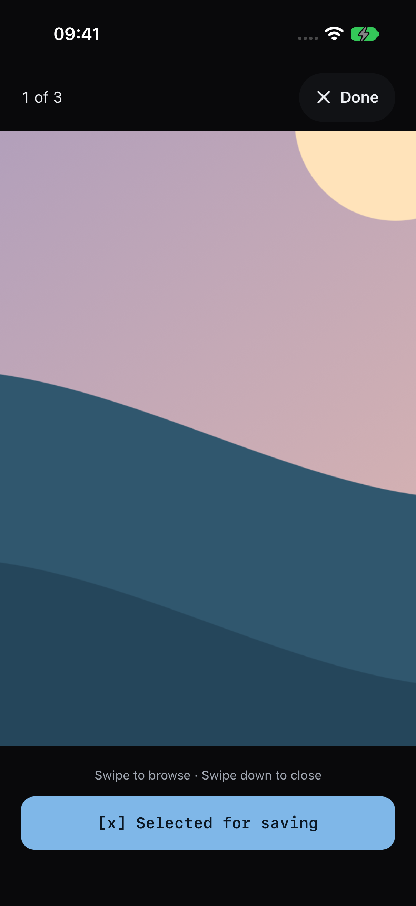

# IGSave

**Instagram media, saved to your iPhone. Native iOS. No ads.**

Preview photos, browse albums and save your favourites directly to Apple Photos. Built with SwiftUI for **iOS 17+**, with a dark terminal-inspired interface, a blue metallic logo and `[x]` / `[ ]` selection controls.

No banners, interstitials, advertising SDKs or app-operated download server.

## Screenshots

| Home | Choose your photos | Full-screen viewer |
| :---: | :---: | :---: |
|  |  |  |

| Zoom in | Select only what you want |
| :---: | :---: |
|  |  |

Real app captures from the iPhone 17 simulator. The landscapes are original demo artwork, not Instagram content. The demo is used for repeatable UI tests; it is not shown in normal use.

## What you can do

- **Paste a link:** use the clipboard icon or type a link and press Search. The **x** button clears the link and results.
- **Preview before saving:** tap a photo, swipe left/right through the album, and pinch or double-tap to zoom. Swipe down to close when not zoomed. Videos have playback controls.
- **Select independently:** tap `[x]` / `[ ]` below a photo, use Select all / Deselect all, or change selection inside the viewer.
- **Save to Photos:** grant add-only photo-library access and save the selected photos/videos. Downloads use the original media URLs.
- **Browse with less waiting:** off-main-actor image decoding, memory-limited caches, neighbouring-photo preloading and a thumbnail placeholder while the larger preview loads.
- **No compulsory login for public posts:** public media is resolved from Instagram's public embed. Optional login is available for content your account can access.

## Try a public album

Copy this link, open IGSave and tap the clipboard icon:

```text
https://www.instagram.com/mlbkorea/p/De8zYb_D6kT/
```

This user-provided public album resolved to **10 photos/videos without login** during development on 2 November 2026. It is an external example, not bundled content: availability and anonymous access can change. Preview only content you may access, and save it only with the owner's permission.

For deterministic screenshots and tests without Instagram, the Debug UI-test mode uses:

```text
https://www.instagram.com/p/IGSaveDemo/
```

**That is a simulated fixture, not a real Instagram post.** It only resolves when the Debug app is launched with `--ui-testing`. Normal builds always use Instagram.

## Build on your iPhone

Requirements: a Mac, **Xcode 15+**, XcodeGen, an Apple Account and an iPhone on **iOS 17+**.

```sh
brew install xcodegen
git clone https://github.com/nobug1312/Insta-saver.git IGSave
cd IGSave
xcodegen generate
open IGSave.xcodeproj
```

1. Select **IGSave → TARGETS → IGSave → Signing & Capabilities**.
2. Enable **Automatically manage signing** and choose your Team. Add your Apple Account in **Xcode → Settings → Accounts** if needed.
3. Connect the iPhone and enable **Settings → Privacy & Security → Developer Mode**.
4. Choose the iPhone as the run destination and press **Cmd+R**.
5. If iOS reports an untrusted developer, trust your account in **Settings → General → VPN & Device Management**.

A free Personal Team is enough; its builds normally expire after seven days. Run from Xcode again to renew.

The GitHub repository keeps the name **Insta-saver**; the app, source folder, project, scheme and target are **IGSave**. The bundle ID `com.local.instasaver` is retained to preserve existing installations. Change it in `project.yml` for a separate installation.

`IGSave.xcodeproj` is generated and Git-ignored. After regenerating, reselect your signing Team.

## Tests and screenshot captures

Run resolver regression tests on macOS:

```sh
xcrun swiftc -parse-as-library \
  IGSave/IGClient.swift IGSave/LinkParser.swift IGSave/Session.swift \
  Tests/IGClientTests.swift -o /tmp/igsave-resolver-tests
/tmp/igsave-resolver-tests
```

Run thumbnail/cache tests and UI tests on an installed simulator:

```sh
xcodebuild -project IGSave.xcodeproj -scheme IGSave \
  -destination 'platform=iOS Simulator,name=iPhone 17' \
  -resultBundlePath /tmp/IGSave-tests.xcresult \
  CODE_SIGNING_ALLOWED=NO test
```

Use an available simulator name and a fresh result-bundle path. UI coverage includes keyboard dismissal, photo zoom, album navigation, swipe-down dismissal, independent selection, clearing and scrolling a 30-photo album.

Export the screenshot attachments:

```sh
xcrun xcresulttool export attachments \
  --path /tmp/IGSave-tests.xcresult \
  --output-path /tmp/IGSave-captures
```

Attachment names identify Home, gallery, viewer, zoom and selection screens. The export command requires a recent Xcode with this `xcresulttool` subcommand.

## Privacy and limitations

- Requests go directly to Instagram and its media CDN. **No ads does not mean no network requests.**
- Login cookies are stored in the device Keychain. Logging out removes the stored cookie and the login web view's website data.
- Instagram's unofficial endpoints can change, disable embeds, rate-limit or block anonymous access, even for public posts. Not every link is guaranteed to work.
- A blocked response is **not proof that content is private**. A login prompt is shown only when returned media explicitly identifies a private account. Login cannot bypass Instagram access restrictions.
- Viewer images are capped at 2048 pixels for responsiveness; saving still downloads from the original media URL.
- IGSave is not affiliated with or endorsed by Instagram or Meta. Respect creators' copyright, privacy and permissions.
